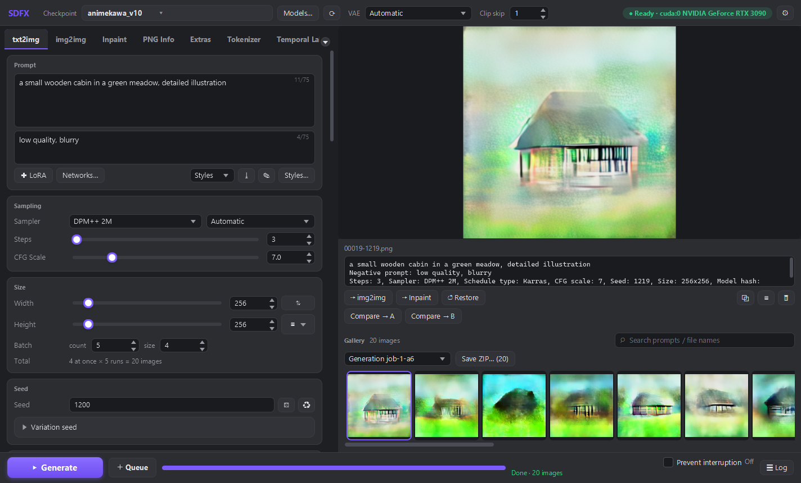

# Stable Diffusion NUI

ローカルのモデルを、ネイティブUIで。画像生成からバッチプレビュー、ギャラリー、ZIP保存まで。

リポジトリ: [kmizu/stablediffusion-nui](https://github.com/kmizu/stablediffusion-nui)。旧名は Stable Diffusion FX / SDFX。



*改名前の SDFX で撮影した旧版の画面：4枚同時 × 5回のバッチ生成結果。現在の製品名は Stable Diffusion NUI。*

**English summary.** Stable Diffusion NUI is a standalone desktop app for local Stable Diffusion image generation:
a Scala 3 + JavaFX 21 UI, an MCP server so AI agents (Claude Code etc.) can generate images, and a Python
`diffusers` engine that the UI drives over a JSON Lines protocol. It lives entirely in this folder and does not
need the parent reForge/A1111 repository (it can optionally *read* an existing A1111/reForge models folder).
Requirements: JDK 17+, Python 3.10-3.12, an NVIDIA GPU is recommended. Quick start: `scripts\build.bat`, then
`run.bat` (or `run.bat --dry-run` to try the UI without a GPU or models).

---

## これは何か

ローカルで動く Stable Diffusion 用のデスクトップアプリです。

- UI: Scala 3 + JavaFX 21(`ui` モジュール)
- MCP サーバー: AI エージェントから画像生成を呼べる(`mcp` モジュール)
- 推論エンジン: Python + diffusers(`python/sdfx`)。UI/MCP から子プロセスとして起動され、stdin/stdout の JSON Lines で通信します
- ビルド: sbt 1.10.11 + sbt-assembly(fat jar 1 本 `target/stablediffusion-nui.jar`)

このフォルダだけで完結します。親ディレクトリの reForge には依存しません。

## 機能

- txt2img / img2img / Inpaint(マスク描画、undo/redo、クリップボード貼り付け)
- Hires. fix
- LoRA(`<lora:name:weight>` タグ、LoRA ピッカー)、VAE 選択、Clip skip
- ControlNet(モデルとプリプロセッサを選択)
- Styles、バリエーションシード、バッチ、キュー、生成中のライブプレビュー(approx / taesd)
- ギャラリー、PNG Info(画像に埋め込まれた生成パラメータの読み出しと各タブへの送信)、Extras(アップスケール)
- プロンプト編集: A1111 の `(強調:1.2)` 記法、`BREAK`、75 トークン単位のチャンク、Ctrl+上下で重み調整
- ダーク/ライトテーマ
- プラグイン(下記)
- MCP サーバー(stdio / HTTP)

### WD v3 バッチ（部分対応）

Img2Img の **WD v3 batch (partial)** は、入力フォルダの画像ごとに WD v3 のタグを作ってから img2img を実行します。モデルは同梱・自動ダウンロードしません。Settings で使う Python 環境に `onnx==1.21.0` と `onnxruntime==1.23.2` が必要です。モデルとタグ CSV の固定バージョン、ハッシュ、設定・再起動手順は [Windows 配布版の説明](docs/WINDOWS_RELEASE.md#wd-v3-batch-interrogation-partial) を参照してください。元のバッチ拡張の全機能には対応していません。

### Temporal Lab

Temporal Lab は、生成済みの連番画像を参照画像に合わせて安定化する DFI のほか、Deflicker、画像列の Fuse、動画からのフレーム抽出を行います。[Abysz LAB](https://github.com/AbyszOne/Abysz-LAB-Ext/tree/deff0d4b4a208f862299b14b93e088f613373153) の画面とアルゴリズムを参照しており、ライセンスと参照元は [THIRD_PARTY_NOTICES.md](THIRD_PARTY_NOTICES.md) に記載しています。

元の実装との完全な数値一致は保証していません。Inter Blur はこのアプリでは処理に反映されます。動画抽出はフレーム番号に基づく時刻を使い、結果は既存の出力を上書きせず新しいフォルダに保存します。処理時には画像サイズやフレーム数などの上限があります。

### 標準プラグイン

reForge の標準スクリプトと内蔵拡張をすべて書き直して同梱しています。対応表は [docs/PLUGINS.md](docs/PLUGINS.md)。

- **Script**(ひとつだけ選択): X/Y/Z plot、Prompt matrix、Prompts from file、Loopback、SD upscale、Poor man's outpainting、
  Outpainting mk2、img2img alternative test、Stable Video Diffusion、Zero123、Custom code(設定で許可した時のみ)
- **Extras**(初期画像、または生成した各画像を加工): Upscale、Restore faces、Caption(BLIP / WD14)、Flipped copies、
  Split oversized、Auto-sized crop、Focal point crop
- **AlwaysOn**(常に適用、個別に ON/OFF): FreeU、Dynamic Thresholding、APG、Mahiro、RescaleCFG、PAG、SAG、HyperTile、
  Kohya HRFix(Deep Shrink)、MultiDiffusion、Advanced Model Sampling、Latent Modifier、Random Resolutions、
  Reference only、Revision、IP-Adapter、ControlNet-LLLite、PhotoMaker、Soft Inpainting、Fooocus Inpaint、Restore faces、
  Never OOM
- **本体機能**: LoRA、ControlNet と前処理(canny / depth / Marigold / recolor / tile / inpaint / controlnet_aux 系)、
  LDSR・SwinIR・SCUNet などのアップスケーラー、プロンプトの括弧チェック

外部プラグインは `plugins-ext/` に jar を置くだけで追加できます(後述)。

## 必要なもの

- JDK 17 以上(`JAVA_HOME` か `PATH` の `java`)
- Python 3.10〜3.12(初回に専用 venv を自動作成します)
- NVIDIA GPU 推奨(torch は CUDA 12.8 ビルドを入れます)。GPU なしでも `--dry-run` で UI は試せます
- ビルドする場合は sbt(jar が既にあれば不要)
- Windows / Linux / macOS(JavaFX は OS ごとの jar をビルド時に取り込みます。別 OS 用の jar はその OS でビルドしてください)

## Windows 配布版（改名後の v0.03 は準備中）

Windows x64 の `SDNUI-v0.03-windows-x64.zip` を入手したら、書き込み可能なフォルダに展開し、`SDNUI\SDNUI.exe` を起動します。
Java ランタイムは同梱されています。Python 3.10〜3.12 は別途必要で、初回の通常起動時に専用環境と依存パッケージをセットアップできます。モデルは同梱されません。Settings → Model folders → **Add A1111/reForge install...** から既存のモデルフォルダを利用できます。詳しい手順は [Windows 配布版](docs/WINDOWS_RELEASE.md) を参照してください。

旧版 v0.01 / v0.02 の配布物は旧名 SDFX のままです。互換性のため、Python モジュール `sdfx`、`SDFX_HOME` / `SDFX_MCP_*`、`-Dsdfx.home` と既存の設定ファイル名は変更していません。

## クイックスタート

```
# 1. ビルド(target/stablediffusion-nui.jar ができる)
scripts\build.bat          # Linux/macOS: scripts/build.sh   (中身は sbt -batch ui/assembly)

# 2. 起動
run.bat                    # Linux/macOS: ./run.sh
```

`run.bat` / `run.sh` は Java 17 以上を探し、jar が無ければ sbt でビルドしてから起動します。
オプション:

| オプション | 意味 |
|---|---|
| `--dry-run` | Python エンジンを `--dry-run` で起動。torch/diffusers を読み込まず、プレースホルダー画像を返します。UI 確認や CI 用 |
| `--home DIR` | アプリのルート(`python/` `models/` `config/` があるフォルダ)を指定。通常は不要(`run.*` が自動で指定) |
| `--mcp` | GUI を起動せず MCP サーバー(stdio)として動作(下記) |

開発用の隠しフラグ: `--screenshot <png>`(起動後に画面を保存)、`--exit-after <秒>`、`--autogen`、`--demo-mask`、`--tab <name>`。

### 初回起動(Python セットアップ)

dry-run でなく、`settings.json` に `python_exe` が無く、`python/.venv` が未作成(または `python/requirements*.txt` が
変わった)場合は、セットアップダイアログが開きます。

1. `python/.venv` を作成(システムの `py -3.12` / `py -3.10` / `python3` / `python` を探します)
2. `python/requirements-torch.txt`(torch / torchvision)を `https://download.pytorch.org/whl/cu128` から導入
3. `python/requirements.txt`(diffusers など)を導入

torch は大きいので時間がかかります。ダイアログでは「dry-run で続行」や「自分の Python を指定」も選べます
(指定すると `python_exe` として保存されます)。手動でやる場合:

```
cd python
python -m venv .venv
.venv/Scripts/pip install -r requirements-torch.txt --index-url https://download.pytorch.org/whl/cu128
.venv/Scripts/pip install -r requirements.txt     # Linux/macOS は .venv/bin/pip
```

### dry-run モード

`run.bat --dry-run` は GPU もモデルも要りません。生成ボタンで seed 固定のプレースホルダー PNG ができ、
進捗・プレビュー・ギャラリー・PNG Info まで通しで動きます。`--mcp --dry-run` なら MCP も同様です。

## モデルの置き場所

`models/` の下に種類ごとに置きます(再帰的に検索)。

```
models/checkpoints/   チェックポイント
models/vae/           VAE
models/lora/          LoRA
models/controlnet/    ControlNet
models/embeddings/    Textual Inversion
models/upscalers/     ESRGAN / SwinIR / SCUNet / DAT 系アップスケーラー(LDSR は自動ダウンロード)
models/face_restore/  GFPGAN / CodeFormer(Restore faces)
models/svd/           Stable Video Diffusion(単一ファイルか diffusers フォルダ)
models/zero123/       Zero123 系(diffusers フォルダ)
models/photomaker/    PhotoMaker v1 アダプタ(photomaker-v1.bin)
models/taesd/         TAESD(プレビュー用、任意)
```

IP-Adapter、ControlNet-LLLite、Fooocus inpaint パッチは、Forge と同じく `models/controlnet/` に置きます。
Revision・IP-Adapter の画像エンコーダ、BLIP、LDSR、Marigold は初回利用時に Hugging Face から取得します。
PhotoMaker を使う場合だけ、追加で `python/.venv/Scripts/python -m pip install --no-deps "git+https://github.com/TencentARC/PhotoMaker.git"` を実行してください。

### 既存の A1111 / reForge の models フォルダを使う

コピーは不要です(読み取り専用で参照)。右上の歯車 → Settings → **Model folders** タブ → **Add A1111/reForge install...**
でインストール先(例 `D:\stable-diffusion-webui-reForge`)を選ぶと、次のフォルダがまとめて追加されます。

`models/Stable-diffusion`、`models/VAE`、`models/Lora` と `models/LyCORIS`、`models/ControlNet`、`embeddings`、
`models/ESRGAN` と `models/RealESRGAN`

種類ごとにフォルダを足し引きすることもできます。保存先は `config/settings.json` の `model_dirs`(絶対パス、または
アプリルートからの相対パス)です。

`from_single_file` で読み込む際、SD1.5 / SDXL のベース設定とトークナイザーを Hugging Face から取得します(初回のみ)。
一度取得したらオフライン運転できます(トラブルシュート参照)。

## 設定ファイル

`config/settings.json`(初回起動時に作成、git 管理外)。Settings ダイアログから編集できます。

| キー | 既定値 | 内容 |
|---|---|---|
| `model_dirs` | 上記 `models/*` | 種類別の検索フォルダ |
| `output_dir` | `outputs` | 出力先(相対はアプリルート基準) |
| `python_exe` | `null` | エンジン用 Python。空なら `python/.venv`、無ければシステム Python |
| `dtype` | `fp16` | `fp16` / `bf16` / `fp32` |
| `vram_mode` | `gpu` | VRAM モード(トラブルシュート参照) |
| `vae_tiling` | `false` | 大きい画像の VAE デコードをタイル化 |
| `preview_every` / `preview_method` | `2` / `approx` | ライブプレビュー間隔(0 で無効)/ `approx` or `taesd` |
| `last_model` / `last_vae` | `null` | 前回のモデル |
| `mcp_http_enabled` / `mcp_http_port` / `mcp_token` | `false` / `7861` / `null` | GUI 内蔵の MCP HTTP サーバー |
| `disabled_plugins` / `plugin_values` | `[]` / `{}` | プラグインの無効化と各コントロールの値 |
| `hf_offline` | `false` | Hugging Face へアクセスしない(`HF_HUB_OFFLINE=1`) |
| `theme` | `dark` | `dark` / `light` |
| `allow_custom_code` | `false` | Custom code スクリプトを許可(A1111 の `--allow-code` 相当。MCP からは常に不可) |

そのほかの状態: `config/ui-state.json`(UI の状態)、`config/styles.csv`(Styles)、`outputs/`(生成画像。
`txt2img/<日付>/` のように種類別、一時ファイルは `outputs/.tmp`)。いずれも git 管理外です。

## キーボードショートカット

| キー | 動作 |
|---|---|
| Ctrl+Enter | 生成(プロンプト入力中でも可) |
| Ctrl+Shift+Enter | キューに追加 |
| Esc | 生成中なら中断 |
| Ctrl+V | img2img / Inpaint の画像エリアでクリップボードの画像を貼り付け |
| Ctrl+Z / Ctrl+Y(Ctrl+Shift+Z) | Inpaint のマスクの undo / redo |
| Ctrl+↑ / Ctrl+↓ | プロンプトで選択範囲の強調の重みを増減 |
| ← / → | ギャラリーの前後の画像(プレビューにフォーカス時) |
| Delete | ギャラリーで選択中の画像を削除 |

(macOS では Ctrl が Cmd になります。)

## MCP(AI エージェントから使う)

画像生成を MCP ツールとして公開します。ツール: `txt2img` `img2img` `txt2img_async` `img2img_async` `get_job` `cancel_job`
`list_models` `set_model` `list_loras` `list_samplers` `list_recent` `get_image` `get_status` `interrupt`
`list_scripts` `run_script`(詳細は [mcp/README.md](mcp/README.md))。

### stdio(ヘッドレス)

GUI なしで専用エンジンを起動します。`run.bat --mcp` は JavaFX を初期化せず `sdfx.mcp.McpMain` を直接起動し、
stdout には JSON-RPC だけを出します(ログは stderr)。

```
claude mcp add stablediffusion-nui -- D:/path/to/stablediffusion-nui/run.bat --mcp
# jar を直接
claude mcp add stablediffusion-nui -- java -cp D:/path/to/stablediffusion-nui/target/stablediffusion-nui.jar sdfx.mcp.McpMain --home D:/path/to/stablediffusion-nui
# GPU なしで試す
claude mcp add stablediffusion-nui-dry -- D:/path/to/stablediffusion-nui/run.bat --mcp --dry-run
```

`.mcp.json` に書く場合は `.mcp.json.example` を参照してください。`McpMain` のオプション: `--home DIR`、`--dry-run`、
`--http [PORT]`(stdio の代わりに HTTP)、`--token TOKEN`(環境変数 `SDFX_MCP_TOKEN` 推奨)、`--allow-dir DIR`(繰り返し可)、
`--drain-seconds N`。

### HTTP(起動中の GUI に接続)

Settings → MCP で **Enable MCP HTTP server** を有効にし(ポート既定 7861、トークン任意)、アプリを再起動します。
エンドポイントは `http://127.0.0.1:7861/mcp`(127.0.0.1 のみ)。ジョブは GUI のキューを通るので、プレビューとギャラリーに出ます。

```
claude mcp add --transport http stablediffusion-nui-gui http://127.0.0.1:7861/mcp
claude mcp add --transport http stablediffusion-nui-gui http://127.0.0.1:7861/mcp --header "Authorization: Bearer <token>"
```

共有マシンではトークンを必ず設定してください(未設定だと同じマシンの他プロセスが生成・キュー操作・許可フォルダの画像読み出しをできます)。

### 読み取りを許可するフォルダ

`init_image` / `mask` / `get_image` が受け付けるファイルパスは、出力フォルダの中と許可フォルダだけです。
許可フォルダは `--allow-dir <dir>`(ヘッドレス)か環境変数 `SDFX_MCP_ALLOWED_DIRS`(Windows は `;`、それ以外は `:` 区切り。
GUI の HTTP サーバーにも効く)で追加します。実パスで判定するのでシンボリックリンクでの脱出はできず、UNC パスは常に拒否されます。
base64 / `data:` URI は常に使えます。

## アーキテクチャ

```
 +------------------------ target/stablediffusion-nui.jar (sbt assembly) -------------------------+
 |                                                                                               |
 |   ui (Scala 3 + JavaFX 21)            mcp (stdio / Streamable HTTP, sdfx.mcp.McpMain)         |
 |     sdfx.ui.Launcher                    |                                                      |
 |         |                               |                                                      |
 |         +---------------+---------------+                                                      |
 |                         v                                                                      |
 |                 plugins (X/Y/Z, FreeU, ...)   <-- plugins-ext/*.jar (ServiceLoader)           |
 |                         v                                                                      |
 |                 engine (AppServices, Generator, PluginRegistry, PythonEnv)                     |
 |                         v                                                                      |
 |                 core (Settings, Protocol, PNG/infotext, plugin API)                            |
 +-------------------------------------------|-----------------------------------------------+
                                             | stdin / stdout : JSON Lines (one JSON object per line)
                                             v
                       python -m sdfx [--dry-run]   (python/sdfx, cwd = python/, venv = python/.venv)
                         server.py -> engine.py (diffusers: txt2img, img2img, inpaint, hires, LoRA, ControlNet)
                                   -> dryrun.py (placeholder engine)
```

- 依存関係は `core <- engine <- plugins <- mcp <- ui`。UI と MCP は同じ `AppServices` を使います。
- エンジンとの通信は 1 行 1 JSON の JSON Lines。ping / interrupt / shutdown は専用スレッドで受け、生成は単一ワーカーキューで順に処理します。
  進捗・プレビュー・ログはイベントとして流れます。契約は `core/src/main/scala/sdfx/core/protocol/Protocol.scala`。
- stdout にはプロトコル行だけを出します。Python 側のログやライブラリ出力は stderr です。
- アプリルートの検出順: `-Dsdfx.home`、環境変数 `SDFX_HOME`、カレントディレクトリ、jar の場所(`python/sdfx` があるフォルダ)。

## 開発

```
sbt test                         # 全モジュール
sbt core/test engine/test        # モジュール単位 (core, engine, plugins, mcp, ui)
sbt ui/run -- --dry-run          # sbt から GUI を起動 (fork)
sbt "mcp/runMain sdfx.mcp.McpMain --dry-run"
sbt "engine/runMain sdfx.engine.tools.Smoke"   # 実 Python パッケージを dry-run で通す結合チェック
cd python && python -m pip install -r requirements-dev.txt && python -m pytest   # torch 不要
```

まとめて実行するスクリプト(失敗すると非 0 で終了):

| スクリプト | 内容 |
|---|---|
| `scripts/smoke.ps1` / `smoke.sh` | Smoke(dry-run) + pytest |
| `scripts/test-all.ps1` / `test-all.sh` | `sbt test`(全モジュール) + pytest |
| `scripts/build.bat` / `build.sh` | `sbt -batch ui/assembly` |

pytest は `python/.venv-test` があればそれを使い、無ければ使い捨ての venv に pytest / pillow / numpy を入れます。

## 外部プラグインの作り方

`sdfx.core.plugins.api.Plugin` を実装し、`java.util.ServiceLoader` で登録した jar を `plugins-ext/` に置きます(再起動で読み込み)。
Plugin は `AlwaysOn`(毎回の生成に介入)か `Script`(ジョブ全体を実行)で、`controls` に宣言した UI 部品は GUI に描画され、
MCP にも JSON スキーマとして出ます。

```scala
package example

import sdfx.core.model.GenerationParams
import sdfx.core.plugins.api.*

final class SuffixPlugin extends Plugin:
  def id = "suffix"
  def name = "Prompt suffix"
  override def description = "Appends text to every prompt."
  def kind = PluginKind.AlwaysOn
  override def controls = Seq(
    Control.Check("enabled", "Enabled"),
    Control.Text("text", "Suffix", defaultValue = ", masterpiece")
  )
  override def process(p: GenerationParams, v: Values): GenerationParams =
    p.copy(prompt = p.prompt + v.str("text"))
```

サービスファイル `src/main/resources/META-INF/services/sdfx.core.plugins.api.Plugin`:

```
example.SuffixPlugin
```

`kind = PluginKind.Script` なら `run(p, v, ctx)` を実装します(`ctx.generate` で生成、`ctx.saveImage` で保存、`ctx.status` / `ctx.isInterrupted` など)。
コンパイル時は `sdfx-core` をクラスパスに置いてください(このリポジトリの `core` に依存する sbt プロジェクト、または `sbt core/package` で作った jar)。
Scala ランタイムは fat jar(`ui` の jar)に含まれているので、プラグイン jar には通常含めなくて構いません(`plugins-ext/` は同じ ClassLoader 階層で読み込まれます)。

## トラブルシュート

- **Java が見つからない / 古い**: `run.bat` が stderr に理由を出して終了コード 1 になります。JDK 17 以上を入れて `JAVA_HOME` を設定してください。
- **起動時に `Unsupported JavaFX configuration` と警告が出る**: fat jar をクラスパスで起動しているための警告で、動作に影響はありません。
- **torch のインストールに失敗する / CUDA が使えない**: `python/.venv` を消して再起動すると再セットアップします。
  CUDA 12.8 の wheel(`cu128`)を使うので、ドライバが古いと GPU を認識しません。`nvidia-smi` で確認し、
  別の CUDA が必要なら手動で `pip install -r requirements-torch.txt --index-url <別の index>` を実行してください。
  Python 3.13 以降は想定外です(3.10〜3.12 を使用)。
- **自分の Python を使いたい**: Settings → Engine → Python に実行ファイルを指定(`python_exe`)。指定した場合はそれだけを使い、
  動かなければ別の Python に黙って切り替えず、エラーにします。
- **Hugging Face に繋がらない / オフラインで使いたい**: 初回の `from_single_file` は SD1.5 / SDXL のベース設定とトークナイザーを取得します
  (`stable-diffusion-v1-5/stable-diffusion-v1-5`、`stabilityai/stable-diffusion-xl-base-1.0`)。一度オンラインで読み込んでキャッシュしたら、
  Settings → Engine の **Offline mode**(`hf_offline`)を有効にすると `HF_HUB_OFFLINE=1` で動きます。
- **VRAM 不足(out of memory)**: サイズ/バッチを小さくする、`vae_tiling` を有効にする、`vram_mode` を変える。
  エンジン(Python)が受け付ける値は `gpu`(全部 GPU)/ `model_offload` / `sequential_offload`(最も省メモリで遅い)です。
  Settings → Engine の VRAM mode で選べます(古い `medvram` / `lowvram` / `cpu` の値は読み込み時に自動で変換されます)。
- **MCP クライアントで JSON パースエラー**: stdout にログが混ざっていないか確認してください。`run.bat --mcp` 自体は何も出力しません。
  独自の起動スクリプトで `echo` や `pause` を入れないでください。JVM 警告を抑えるには `-Xlog:disable -Xlog:all=warning:stderr -Djava.awt.headless=true`。
- **エンジンが起動しない**: 画面右下の Log を開いて確認します。`run.bat --dry-run` で UI だけ確認すると切り分けられます。

## ライセンス

AGPL-3.0（`LICENSE`）。AUTOMATIC1111 web UI・Forge・reForge（AGPL-3.0）と ComfyUI・Fooocus（GPL-3.0）の処理を移植しているためです。
移植元・再実装元・依存ライブラリごとのライセンスは `THIRD_PARTY_NOTICES.md` と `licenses/` にあります（`python scripts/third_party.py` で再生成）。
